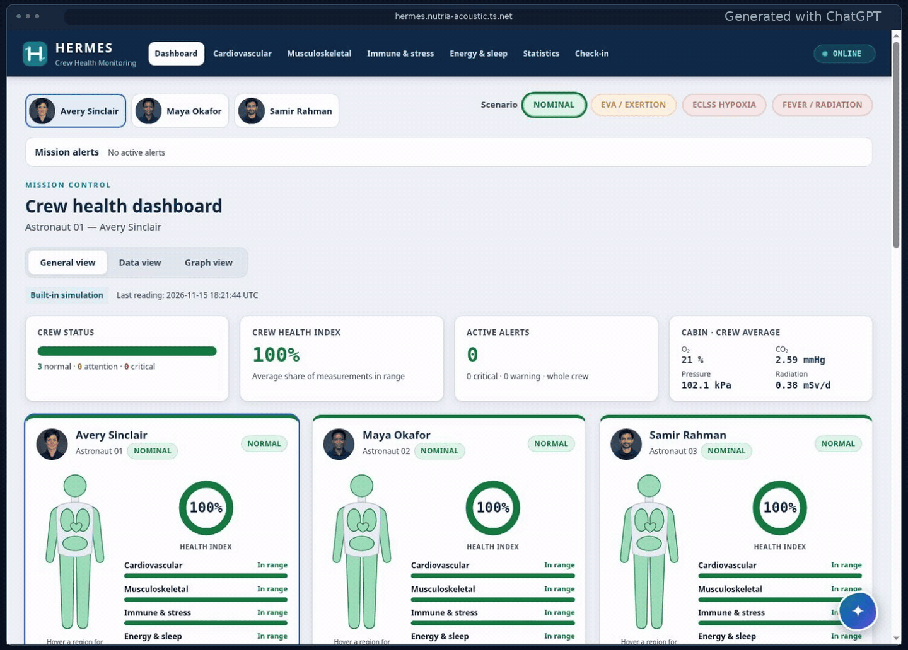

HERMES — Crew Health Monitoring for Space Missions
HERMES is a browser-based prototype for monitoring crew health and spacecraft cabin conditions during long-duration missions. It combines 26 simulated measurements, mission-wide alerts, personal well-being and vision check-ins, and an on-demand AI assistant. A crew member can start with the mission overview, identify who is affected, inspect the readings behind an alert, and decide what to verify next.

HERMES was developed for the 2026 NASA Space Apps challenge Create Health Monitoring Software for Astronauts on Space Missions. The prototype uses fictional crew profiles and generated telemetry. Its screening tasks and alert thresholds are intended for demonstration and require clinical validation before operational use.

Open the HERMES demo
Quick start on Windows
1. Extract the complete project folder.
2. Open hermes and double-click INSTALL_AND_START.bat.
3. Select the launch mode.
Option	What it prepares	How to connect
1. Run locally with AI	PHP, Ollama, and the llama3.2 model	Open localhost:8090.
2. Publish with Tailscale Funnel and AI	The local components plus Tailscale	Sign in to Tailscale and approve Funnel if prompted. Share the URL printed in the console.
3. Run locally with AI and the Python API	The local components plus Python and the API dependencies in .venv	Open localhost:8090. The API documentation is at localhost:8000/docs.

Setup uses WinGet to install missing applications and needs internet access for downloads. See WINDOWS_SETUP.txt for the full instructions. Keep the server window open while using HERMES. Visitors use their browsers, and Ollama runs on the host.

For a direct launch with PHP 8.0 or later already available, use START.bat. It looks in C:\php\php.exe and on the system PATH. Set PHP_EXE to use a different installation. You can also run the built-in simulator from the project directory:
php -S 127.0.0.1:8090 -t web
Serve only web/ as the document root. Keep storage/ writable and outside that root.
What HERMES monitors
Area	Measurements
Cardiovascular	Heart rate, blood oxygen saturation, systolic and diastolic blood pressure, respiratory rate, and heart rate variability
Musculoskeletal	Muscle activity, exercise duration, estimated bone loss, grip strength, and steps
Immune and stress	Stress level, electrodermal activity, cortisol, and body temperature
Energy and sleep	Energy expenditure, sleep duration, sleep quality, and hydration
Cabin and sensors	Cabin temperature, humidity, carbon dioxide, oxygen, pressure, radiation, and sensor availability

The General view shows three crew profiles, a mission alert count, a crew status comparison, and health indicators for each astronaut. Select a portrait to switch the crew member in focus. The Data view shows current readings and units, and the Graph view shows how those readings change over time. The system pages group related measurements for more focused review. On an active dashboard, live readings update once per second and timestamps are shown in UTC.

The Mission alerts banner stays visible across pages. It identifies the affected astronaut, shows the reason for each flag, and sorts alerts by severity. Alerts are calculated from explicit rules, independently of the AI assistant.
Simulation and review workflow
Each scenario changes the readings for the selected crew member. Values move progressively toward the scenario targets with bounded variation, so users can observe a trend as it develops.
Scenario	What to look for
Nominal	The reference pattern for routine operations
EVA / Exertion	Changes in heart rate, breathing, and activity during simulated exertion
ECLSS Hypoxia	A decline in both cabin oxygen and blood oxygen saturation during a simulated life-support fault
Fever / Radiation	An increase in body temperature alongside simulated cabin radiation exposure

For a walkthrough, select an astronaut and apply ECLSS Hypoxia. Follow cabin oxygen and blood oxygen saturation together in the graphs. When a rule triggers, use the alert to identify the crew member and inspect the readings that prompted it. Open Statistics to compare the current measurements with earlier values. If Ollama is available, ask the assistant which recorded readings would help verify the change.
History, statistics, and export
Statistics lets users choose an astronaut and review the last five minutes, hour, or 24 hours, all recorded history, or a custom UTC range. For each measurement, it shows the number of samples, most recent value, mean, sample standard deviation, minimum, and maximum. The selected metric also has a historical chart and an observed histogram. A fitted normal curve is shown when the data support calculating one and serves as a descriptive reference.

Export CSV includes all records in the selected time range, including the 26 measurements, timestamps, crew identifiers, and scenario labels. This allows an analysis to be reproduced from the same readings.
Crew health check-ins
- Well-being: Four self-ratings, a five-trial reaction-time task, and an optional voice note.
- Vision: An Amsler grid to record perceived distortion or missing areas and a Tumbling E task to assess letter orientation at calibrated sizes. Each eye is tested separately. A screen calibration step sets the on-screen size of the letters.
- Baseline comparison: The first check-in establishes a personal reference. Later check-ins show changes in reaction time, self-ratings, and vision responses. A crew member can explicitly replace their baseline. Recent flagged check-ins also appear in the mission alert banner.
- Demo data: The crew summary can load labelled sample check-ins. Check-ins are shared across visitors to the same deployment, including when telemetry simulations are separate. Use fictional entries in public demonstrations.
HERMES Crew AI Assistant
Open the floating assistant from any page. Select Request crew summary for an overview of all three astronauts or submit a question about an individual, a trend, or an alert. The assistant receives recent readings, summary statistics, available check-in results, and recent conversation context. It can explain a reading or suggest which data to verify when the question calls for it.

The conversation, draft, and pending reply stay in the same tab during navigation through the dashboard. HERMES sends a model request only after a user submits a question or requests a summary. A background PHP worker calls Ollama on the host. If Ollama is unavailable, the dashboard, history, and rule-based alerts remain available.
Architecture and data flow
Component	Role
web/	PHP pages and endpoints, JavaScript for live updates, and SVG charts
web/sim_local.php	Built-in simulator, scenario transitions, history, and alert rules
web/metrics.php	Shared catalog of measurements, categories, units, and display precision
server/generator.py	Generates telemetry continuously in API mode and submits it in batches
server/api.py	FastAPI service for telemetry, alerts, history, check-ins, and scenario changes
worker/ollama_worker.php	Processes requests for AI summaries and answers
storage/	File-based simulation records and shared check-in data
tests/	Statistics, API, and browser checks

In built-in mode, the PHP simulator generates data as the web app is used and persists history in JSON Lines files. By default, browsers receive separate telemetry histories and scenario selections. Long inactive periods can leave gaps because the simulator only backfills a limited interval when a browser returns.

In API mode, the Python generator sends samples to the FastAPI service, which stores telemetry and check-ins in SQLite. The PHP interface reads from that service. The API exposes recent readings at /api/latest, queryable history at /api/history, and active alerts at /api/alerts. Start this mode through option 3 or use START_WITH_PYTHON.bat after setting up PHP and Python 3.10 or later.
Configuration
Set these environment variables before starting the relevant processes.
Variable	Purpose	Default
HERMES_DATA_SOURCE	Selects the built-in simulator (local) or Python service (api)	local
HERMES_API_URL	Address of the Python telemetry service	http://127.0.0.1:8000
HERMES_API_KEY	Shared key for the web app, API, and generator	Bundled demo key
HERMES_DB_PATH	SQLite file used in API mode	server/hermes_received.db
HERMES_STORAGE_DIR	Sets an explicit storage folder and shares the built-in simulation	Project storage/ folder
HERMES_PER_VIEWER	Set to 0 to use one shared built-in simulation	Per-browser simulations enabled
HERMES_MISSION_START	First mission day in UTC (YYYY-MM-DD)	2026-11-01
HERMES_AI	Set to 0 to disable the assistant	Enabled
HERMES_OLLAMA_MODEL	Model used for answers and summaries	llama3.2
HERMES_OLLAMA_URL	Address of the Ollama service on the host	http://127.0.0.1:11434
HERMES_AI_TTL	Time in seconds for which matching summary results can be reused	60

Preserve storage/ when updating an installation. In API mode, also preserve the SQLite database. Back up those files while the corresponding services are stopped.
Project checks
Run the commands below from the project root.
Command	Coverage
node tests/statistics.test.js	Summary statistics, histogram calculations, CSV escaping, and chart data handling
python tests/test_api.py	Crew isolation, history, authentication, and check-ins using a temporary database. Requires the project Python dependencies and httpx.
python tests/run_browser.py	Browser smoke test against local services. Requires PHP, the project Python dependencies, Node.js, Playwright, and Chromium.
